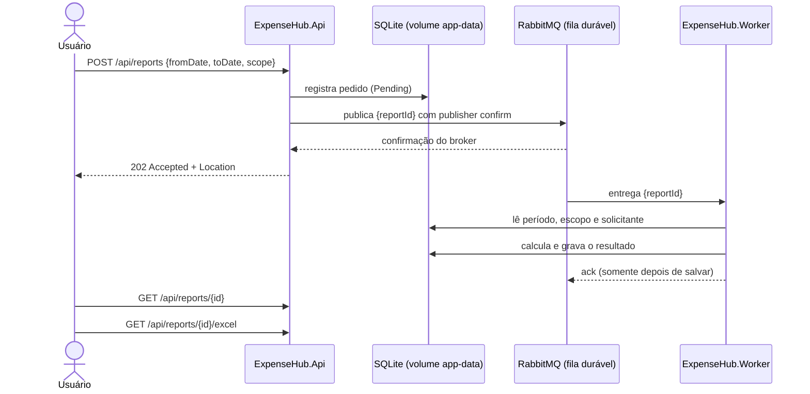

# ExpenseHub — Checkpoint 3

> API corporativa de reembolsos com **geração de relatórios em segundo plano**.

A API registra o pedido de relatório e devolve a resposta na hora. Um **worker C#** processa o cálculo de forma assíncrona via **RabbitMQ**. O usuário acompanha o andamento pelo `id` e baixa o resultado em **Excel (.xlsx)**.

## Sumário

- [Integrantes](#integrantes)
- [Entrega](#entrega)
- [Como funciona](#como-funciona)
- [Arquitetura](#arquitetura)
- [Endpoints](#endpoints)
- [Como executar](#como-executar)
- [Testes](#testes)
- [Documentação complementar](#documentação-complementar)

---

## Integrantes

| Nome | RM |
|---|---|
| Victor Mattenhauer Lopes Capp | 555753 |
| Artur Alves Tenca | 555171 |
| Igor Brunelli Ralo | 555035|

## Entrega

**Especificação:** issues `CP3-I01` a `CP3-I07` do repositório [Racass/checkpoint-csharpracass-expensehub](https://github.com/Racass/checkpoint-csharpracass-expensehub/issues?q=is%3Aissue+CP3).

| Referência | Commit |
|---|---|
| Base do CP2 | `PREENCHER` |
| Entrega final do CP3 | `PREENCHER_SHA_FINAL` |

> **Observação:** o grupo não entregou o CP2. A base foi construída neste repositório a partir do template.

---

## Como funciona



Pontos-chave do fluxo:

1. **O `202` só sai depois de duas garantias:** o pedido está salvo no banco **e** o broker confirmou a publicação. Sem confirmação, a API responde `503` com o `id` do pedido.
2. **A mensagem carrega apenas o `reportId`.** Período, escopo e solicitante são lidos do banco pelo worker. O solicitante vem sempre do token, nunca do corpo da requisição.
3. **O worker só confirma (`ack`) depois de persistir.** Se cair no meio, a mensagem volta para a fila e o processamento é retomado.

Detalhes de fila, confirmações, idempotência e tratamento de falhas: [docs/CP3-OPERACAO.md](docs/CP3-OPERACAO.md).

---

## Arquitetura

### Estrutura do repositório

```text
sources/
├── ExpenseHub.Core/        domínio, EF Core (SQLite), regras de reembolso e de relatório, geração do Excel
├── ExpenseHub.Api/         endpoints (Identity bearer, CP2 e CP3) e publisher RabbitMQ
├── ExpenseHub.Worker/      consumidor RabbitMQ (BackgroundService)
└── ExpenseHub.UnitTests/   MSTest, sem banco, rede ou RabbitMQ reais
docker/                     Dockerfiles da API e do worker
compose.yaml                RabbitMQ + imagens publicadas + volumes persistentes
```

### Decisões técnicas

| Tema | Decisão |
|---|---|
| **Banco** | SQLite em arquivo no volume `app-data`, compartilhado pela API e pelo worker (modo WAL e `Default Timeout=30`). |
| **Schema** | Criado por `EnsureCreated` na subida da API (sem migrations). |
| **Seed** | A API cria as roles e a única conta Admin a partir de variáveis de ambiente. |
| **Autenticação** | ASP.NET Core Identity com bearer token (`POST /register`, `POST /login`). |
| **Persistência de tokens** | Chaves de Data Protection em `/data/keys`: os tokens continuam válidos após recriar os contêineres. |
| **Troca de roles** | Alterar as roles de um usuário invalida os tokens dele. |

---

## Endpoints

| Método e rota | Respostas |
|---|---|
| `POST /api/reports` | `202` + `Location` + envelope · `400` datas ou escopo inválidos · `403` perfil sem permissão para o escopo · `503` com `id` se a publicação não foi confirmada |
| `GET /api/reports` | `200` com as solicitações **do próprio usuário** |
| `GET /api/reports/{id}` | `200` envelope · `404` se inexistente ou de outro usuário (inclusive para Auditor) |
| `GET /api/reports/{id}/excel` | `200` arquivo `report-{id}.xlsx` · `409` relatório próprio ainda não concluído ou `Failed` · `404` se de outro usuário |

Corpo do `POST`:

```json
{ "fromDate": "2026-01-01", "toDate": "2026-01-31", "scope": "Mine" }
```

### Permissões por escopo

| Escopo | Perfil exigido |
|---|---|
| `Mine` | Employee |
| `Global` | Auditor |

Admin, Approver e Finance que não tenham esses perfis recebem `403`.

---

## Como executar

### Opção 1 — Imagens publicadas (recomendado)

**Pré-requisito:** Docker com Compose.

```bash
cp .env.example .env     # preencha WEB_IMAGE, WORKER_IMAGE (tag = SHA do commit) e as senhas
docker compose pull
docker compose up -d
docker compose ps
```

Verificação:

```bash
curl http://localhost:8080/health          # {"status":"ok","version":"<sha>"}
docker compose logs --tail 80 worker
```

| Recurso | Endereço |
|---|---|
| API | http://localhost:8080 |
| OpenAPI | http://localhost:8080/openapi/v1.json |
| Painel do RabbitMQ | http://localhost:15672 (usuário e senha do `.env`) |

**Roteiro de testes manuais:** [sources/ExpenseHub.Api/ExpenseHub.Api.http](sources/ExpenseHub.Api/ExpenseHub.Api.http). Ele cria os usuários e os dados da tabela da apostila, e cobre o fluxo completo e os casos negativos.

### Opção 2 — Localmente, sem Docker para a aplicação

Suba apenas o RabbitMQ:

```bash
docker run -d --name rabbit -p 5672:5672 -p 15672:15672 rabbitmq:4-management
```

Configure e rode a API:

```bash
cd sources
dotnet user-secrets init --project ExpenseHub.Api
dotnet user-secrets set "Seed:AdminEmail" "admin@expensehub.local" --project ExpenseHub.Api
dotnet user-secrets set "Seed:AdminPassword" "<senha>" --project ExpenseHub.Api
dotnet user-secrets set "RabbitMq:Password" "guest" --project ExpenseHub.Api
dotnet run --project ExpenseHub.Api --urls http://localhost:8080
```

Em outro terminal, rode o worker (por padrão ele usa `../ExpenseHub.Api/expensehub.db`):

```bash
RabbitMq__Password=guest dotnet run --project ExpenseHub.Worker
```

### Publicação das imagens (CI)

O workflow [`images`](.github/workflows/images.yml) roda os testes unitários e, **somente se passarem**, publica no GHCR as duas imagens com a tag igual ao SHA completo do commit:

```text
ghcr.io/<owner>/expensehub-web:<sha>
ghcr.io/<owner>/expensehub-worker:<sha>
```

O commit também fica registrado no label `org.opencontainers.image.revision` e na variável `APP_VERSION`, exibida em `/health` e no log de inicialização do worker.

> **Importante para a correção:** os pacotes precisam estar públicos para o `docker compose pull` funcionar.
> GitHub → Packages → pacote → Package settings → Change visibility → **Public**.

---

## Testes

```bash
dotnet test sources/ExpenseHub.slnx
```

Os testes não usam banco, rede nem RabbitMQ reais: usam fakes de repositório, publisher e store do worker.

| Área | O que é coberto |
|---|---|
| **Cálculo** | Dados da apostila (Mine: 3 / R$ 175,00 · Global: 4 / R$ 375,00), limites inclusivos do período, conjunto vazio |
| **Validação e acesso** | Validação de período, negações por perfil e escopo, isolamento por solicitante |
| **Mensageria** | Publicação sem confirmação (`503`), mensagem duplicada sem novo efeito |
| **Processamento** | Consulta sem recálculo após alterar reembolsos, retomada de `Processing`, falha definitiva |
| **Excel** | Planilha válida, células numéricas, respostas `409` e `404` |

---

## Documentação complementar

| Documento | Conteúdo |
|---|---|
| [docs/CP3-OPERACAO.md](docs/CP3-OPERACAO.md) | Fila, confirmações, idempotência e tratamento de falhas |
| [docs/CP3-DOSSIE.md](docs/CP3-DOSSIE.md) | Evidências operacionais (E01–E05) |
